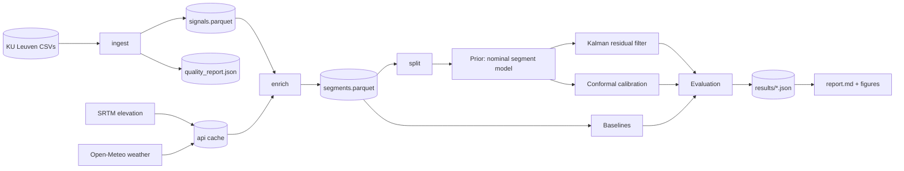

# evprior — Blueprint

**Working title:** *From prior to posterior: pre-trip and dynamic remaining-energy prediction for battery-electric vehicles, with calibrated uncertainty*

Scope note (project-blueprint rules 1-7 apply). This is a **research repository**, not a service. Sections that do not apply are collapsed and listed in §0 with the reason. Nothing in this document is a result; results are produced only by running the pipeline.

## 0. Collapsed sections

| Blueprint section | Treatment | Why |
|---|---|---|
| 3 Actors, 14 Frontend, 16 Security (authn/z), 27 Threat model | Collapsed to §16 | No users, no network service. Only data-licence and supply-chain concerns. |
| 8 API, 9 Events, 10 State, 15 Jobs, 25 Deployment | Replaced by a CLI stage graph (§8) | Batch pipeline run on one workstation. No server, queue or cloud. |
| 12 LLM architecture | Not applicable | No LLM in the system. |
| 28-31 Roadmap/build/rules | §20-§21 | Kept, scaled. |

## 1. Executive summary

**Problem.** Remaining-energy estimates in a BEV are made twice: before the trip, from route and context only, and during the trip, when real consumption is observed. Most systems treat these as separate models. The thesis question (Geely Tech EU brief) is how to bridge them.

**Approach.**
1. A *nominal* data-driven model predicts energy per 1 km route segment from information known before departure. Its sum is the pre-trip estimate. This is the **prior**.
2. A *trip-level latent consumption factor* (driver, vehicle state, weather and traffic effects not in the features) is tracked online with a Kalman filter (Gaussian state-space, log-multiplier). Each completed segment is an observation. The filtered state rescales the nominal prediction of the remaining segments. This is the **posterior**.
3. Predictive uncertainty is **calibrated** (conformal wrapper on the prior; filter variance plus conformal inflation on the posterior) and judged by decision quality, not only RMSE.
4. A **handover curve** shows, as a function of distance driven, when the online estimate becomes better than the pre-trip estimate, and how that depends on context.

**Dataset (real, public).** KU Leuven BEV energy-dynamics dataset (Yasko et al., Sci. Data 2025; DOI 10.48804/8KPDTW; CC BY 4.0): 2 Tesla Model Y (BEV1 LFP, BEV2 NCA), 1,396 driving sessions, ~12 months, 1 Hz CAN-derived signals with GPS. Enriched with open elevation (SRTM via OpenTopoData) and open weather (Open-Meteo archive).

**Key technical challenges.** (a) No planned route or elevation in the data: must be reconstructed honestly. (b) Broken odometer on BEV1. (c) Small number of vehicles: vehicle-level generalisation can only be tested with n=2. (d) Mixed-rate signals (speed at ~0.5 Hz in early BEV1 files). (e) Preventing leakage between pre-trip features and in-trip observations.

## 2. Requirements

| ID | Requirement | Tag |
|---|---|---|
| F1 | Ingest all driving-session CSVs, validate schema, produce a typed Parquet trip table and a 1 Hz cleaned signal table with a per-trip quality report | must |
| F2 | Compute trip energy label from ∫V·I dt and cross-check against BMS counters; record disagreement | must |
| F3 | Derive distance from speed integration and GPS; cross-check; reject trips failing consistency | must |
| F4 | Enrich with elevation and weather from open APIs with on-disk cache; pipeline must run offline once cache is filled | must |
| F5 | Build 1 km segments with features split strictly into *pre-trip* and *in-trip* groups | must |
| F6 | Train pre-trip prior (segment model summed to trip) and compare with direct trip-level models | must |
| F7 | Online filter for remaining-energy; evaluate at fixed checkpoints (km driven and fraction) | must |
| F8 | Baselines: static prior, rate extrapolation, blended rate, learned in-trip GBM | must |
| F9 | Calibration metrics (PICP, interval width, pinball, CRPS-from-quantiles) and decision metrics (reserve-violation) | must |
| F10 | Robustness: leave-vehicle-out, forward-chaining by month, season-out, signal-dropout and GPS-noise perturbations | must |
| F11 | Interpretability: feature attributions for prior; filter-state trajectories; per-condition error tables | should |
| F12 | Learned process-noise (context-dependent q) variant | should |
| F13 | GRU sequence baseline | could |
| F14 | Second external dataset (VED Nissan Leaf, 3 BEVs) for cross-dataset transfer | could |
| N1 | Reproducible: one command per stage, fixed seeds, pinned dependency ranges, results written to JSON and rendered into the report | must |
| N2 | No number in README/report typed by hand | must |
| N3 | Whole pipeline < 30 min on a laptop CPU | should |
| N4 | Typed code, unit tests on algorithms (filter, splitting, leakage guard) | must |

## 3. Architecture



Python package `evprior`, one module per stage, pure functions on Polars frames. No framework. Parquet on disk is the only inter-stage interface.

## 4. Data architecture

### 4.1 Source semantics (verified by inspection, 2026-10-04)

* Files: `driving sessions/BEVn_YYYY-MM-DD_driveK.csv`, 26 columns (BEV1) or 34 columns (BEV2).
* Signals used: `Timestamp`, `BattVoltage132` (V), `RawBattCurrent132` (A, positive = discharge), `SOCave292` (%), `DI_uiSpeed` (km/h), `Odometer3B6`, `GPSLatitude04F`, `GPSLongitude04F`, `VCFRONT_tempAmbient` (°C), `TotalDischargeKWh3D2`, `TotalChargeKWh3D2` (kWh counters), `BMSminPackTemperature`, `BMSmaxPackTemperature`.
* Signal rates differ per signal (speed and odometer sparse in early files). Forward-fill with a maximum age (config) and record fill ratio.
* Odometer for BEV1 is not usable (values around -4.2e6). Distance is **derived**, not read.
* ∫V·I dt agrees with the BMS counter delta (median ratio 1.002, ~183 Wh/km median). Counters contain glitches (negative trip energies down to -33 kWh), so the integral is the label and the counter is a validator.

### 4.2 Entities

| Entity | Key | Fields (type, constraints) | Source of truth |
|---|---|---|---|
| `signals` | (trip_id, t) | t: datetime, v_batt: f64>0, i_batt: f64, soc: f64 in [0,100], speed_kmh: f64>=0, lat, lon: f64, amb_c: f64, pack_tmin/max: f64 | cleaned CSV |
| `trips` | trip_id | vehicle: cat, start_ts, duration_s, dist_km_speed, dist_km_gps, energy_kwh_vi, energy_kwh_counter, soc_start, soc_end, quality flags (bool), keep: bool, drop_reason | derived |
| `elevation_cache` | (lat_r, lon_r) rounded to 1e-4° | elev_m | OpenTopoData SRTM30m |
| `weather_cache` | (cell, hour) | temp, wind_speed, wind_dir, precip, humidity | Open-Meteo archive |
| `segments` | (trip_id, k) | k, dist_km, e_kwh, mean_speed, elev_gain_m, elev_loss_m, grade_mean, hour, weekday, amb_start, amb_obs, wx_*, start_soc, vehicle, **pre_** and **obs_** prefixed feature groups | derived |
| `splits` | trip_id | fold definitions per scheme | derived, deterministic |

Retention: raw data is read-only and git-ignored; derived Parquet is regenerable; API caches are kept.

### 4.3 Leakage rule (central design constraint)

Every feature column is prefixed `pre_` (knowable at departure from route, calendar, weather forecast proxy, vehicle, start SOC, history of *earlier* trips) or `obs_` (measured during this trip). The prior may read only `pre_*`. A unit test fails the build if any prior model's feature list contains an `obs_*` name. Weather uses archive reanalysis as a stand-in for a forecast; this is optimistic and is reported as a limitation. A "planned route" does not exist in the data; the realised GPS polyline is used as the planned route (optimistic, stated limitation, same assumption as most public-data studies).

## 5. Methods

### 5.1 Trip filtering
Keep a trip if: duration >= `min_duration_s`, distance (speed integral) >= `min_dist_km`, `|dist_speed - dist_gps| / dist_speed <= max_dist_disagreement`, `energy_vi` within [`min_kwh`, `max_kwh`], voltage/current coverage >= `min_signal_coverage`. Each drop gets a reason; counts are reported.

### 5.2 Prior (nominal segment model)
Target per segment: `e_kwh`. Features `pre_*` only: distance, elevation delta, gain/loss, mean absolute grade, ambient temperature, wind component along heading, precipitation, hour, weekday, start SOC, vehicle, and a **planned-speed proxy** computed leakage-safely from *training* trips only (median speed of training segments in the same ~500 m grid cell, fallback to global). Model: gradient-boosted trees with monotone constraint where physical (energy non-decreasing in distance), compared with (i) physics-only road-load regression, (ii) physics + GBM residual, (iii) direct trip-level GBM, (iv) mean Wh/km.

Trip prior = sum of segment predictions. Variance: quantile or residual-scale model on trip features, then conformal calibration.

### 5.3 Online adaptation (posterior)
State `theta_k = log` of the trip's consumption multiplier relative to the prior. Model: `theta_k = theta_{k-1} + w_k`, `w_k ~ N(0, q)`; observation `r_k = log(e_k / ê_k)`-style ratio with heteroscedastic noise `R_k = sigma_obs^2 / max(ê_k, e_min)` (short, low-energy segments are noisier). Initial `theta_0 ~ N(0, P0)` where `P0` is estimated from training residuals of the prior. `q`, `sigma_obs` fit by maximum likelihood on training trips (never test). Remaining-energy forecast at checkpoint `k`: `sum_{j>k} ê_j * exp(theta_k + 0.5 P_k)` with predictive variance by moment matching and added segment-level noise. Alternatives kept as ablations: ratio-only (no process noise), exponential forgetting, learned context-dependent `q` (F12).

### 5.4 Baselines at every checkpoint
1. **Static prior** (no update).
2. **Rate extrapolation**: observed kWh/km so far × remaining km (the common industry heuristic).
3. **Blend**: weight between prior and rate extrapolation, weight a function of distance driven fitted on training trips.
4. **Learned in-trip GBM**: features = prior remaining estimate + observed-so-far aggregates + remaining route features; trained on checkpoints from training trips.
5. (could) GRU on segment sequences.

### 5.5 Evaluation protocol
* Checkpoints: fixed km (1, 2, 5, 10, 20 km) and fraction (10 ... 90 %), whichever is defined for the trip.
* Metrics: MAE, MAPE guarded for small denominators (report both absolute kWh and Wh/km-equivalent), bias, PICP at 80/90 %, mean interval width, pinball loss, CRPS from quantiles, reliability curves.
* Decision metric: "arrive with at least R kWh reserve" — report false-safe and false-alarm rates for the predicted decision at threshold, `R` from config.
* **Handover curve**: error vs km driven per method; handover point = first checkpoint where posterior MAE is lower than prior MAE with a paired bootstrap CI (trip-level resampling) excluding zero.
* Splits (all trip-level; no segment from a test trip ever touches training): (a) random 5-fold CV grouped by day (avoids same-day leakage), (b) forward-chaining by month, (c) leave-one-vehicle-out (n=2, reported with that caveat), (d) season-out (train non-winter, test winter and reverse).
* Perturbations: speed-signal dropout at p, GPS jitter sigma, observation delay, to test filter robustness.
* Statistics: bootstrap CIs over trips; report effect sizes, not only p-values. Weak or negative results are stated plainly.

## 6. Configuration

All tunables live in `config/default.yaml`, validated by a typed loader (pydantic-free dataclasses with explicit checks to keep dependencies small). Secrets: none required (both APIs are keyless). Overrides via `--config` and `EVPRIOR_*` env vars. Changing config needs no code change; changed config changes the run hash written into every result file.

Config groups: `paths`, `ingest` (thresholds, max fill age), `enrich` (API URLs, batch size, rate limit, cache dir, retries), `segments` (length_km), `prior`, `filter`, `eval` (checkpoints, reserve kWh, bootstrap n, seeds), `splits`.

## 7. Failure and recovery

| Component | Failure | Detection | Handling |
|---|---|---|---|
| ingest | malformed CSV / missing column | schema check | trip dropped with reason `schema`; run fails if > configured fraction dropped |
| ingest | counter glitches | counter vs integral disagreement | label stays integral; flag recorded |
| enrich | API timeout / 429 | HTTP status | exponential backoff, resume from cache; cache write is atomic per batch |
| enrich | API result missing a point | null in response | interpolate along polyline, flag; fail if flagged fraction > config |
| enrich | offline | connection error | use cache; if cache incomplete for a needed key, stage exits non-zero with the missing count |
| filter | numerical instability | non-finite state | clamp variance floor; checkpoint flagged and excluded, counted |
| splits | empty fold | assertion | fail fast |
| any stage | partial output | temp file + atomic rename | rerun is idempotent |

## 8. Pipeline stages (CLI)

`python -m evprior <stage>` with stages `ingest, enrich, segments, prior, filter, baselines, evaluate, robustness, report, all`. Each reads Parquet/JSON, writes Parquet/JSON, is idempotent, and logs row counts and drop reasons.

## 9. Testing strategy

* Unit: energy integral on synthetic constant power; distance integration; segmenter conserves energy and distance; Kalman filter recovers a known synthetic multiplier and has calibrated coverage on simulated data; leakage guard; conformal coverage on exchangeable synthetic data; split functions never share a group across train and test.
* Integration: tiny real fixture (3 trips) through all stages.
* Failure injection: truncated CSV, NaN voltage block, API stub returning 429 (stub only in tests, never in the pipeline).
* ML evaluation is the experiments themselves.

## 10. Repository structure

```
evprior/
  config/default.yaml
  docs/BLUEPRINT.md
  src/evprior/{config,ingest,enrich,segments,prior,kalman,baselines,calibrate,evaluate,robustness,report,cli}.py
  tests/
  data/raw/        (git-ignored; dataset downloaded by scripts/get_data.py)
  data/interim/    (git-ignored Parquet)
  results/         (JSON + figures, committed once final)
  scripts/get_data.py
  pyproject.toml, README.md, LICENSE, .gitignore
```

## 11. Dependencies
polars, numpy, scipy, scikit-learn, lightgbm or xgboost (xgboost already present; used for GBM), matplotlib, pyarrow, pyyaml, requests, pytest. No deep-learning dependency unless F13 is built (torch is present locally). No web framework, no database.

## 12. Local development
`pip install -e .[dev]`; `python scripts/get_data.py` (downloads the 162 MB zip from the KU Leuven repository by DOI file id); `python -m evprior all`; `pytest`.

## 13. Risks

| Risk | Consequence | Mitigation |
|---|---|---|
| Only 2 vehicles | leave-vehicle-out has little statistical power | state n=2; add VED Leafs as optional external set (F14); report as a limitation |
| Realised route used as planned route | prior optimistic | explicit limitation; ablate by perturbing route (drop elevation) |
| Archive weather ≠ forecast | optimism | limitation; ablate weather features |
| Sparse speed in early BEV1 | feature noise | fill ratio tracked; sensitivity test |
| Winter share unevenly distributed across vehicles | season confounded with vehicle | report season-out per vehicle |
| Tiny segments noisy | filter over/under-reacts | heteroscedastic R; segment length is a config and an ablation |
| Overstated conclusions | credibility | results only from `results/*.json`; negative results kept |

## 14. Architectural decision records

| # | Decision | Alternatives | Reason |
|---|---|---|---|
| 1 | Label = ∫V·I dt | BMS counters; ΔSOC×capacity | counters have glitches; SOC is coarse (0.1 %) and capacity unknown; integral agrees with counters |
| 2 | Distance from speed integral, GPS as check | odometer | BEV1 odometer broken |
| 3 | Segment-level nominal model, summed for the prior | direct trip-level model only | gives a per-segment forecast needed for remaining energy, yet compared against direct model |
| 4 | Kalman filter on log-multiplier | particle filter, RLS, learned GRU | closed form, interpretable state, cheap, matches brief's "online state estimation" |
| 5 | Conformal calibration | pure Gaussian intervals | distribution-free coverage under exchangeability; coverage under shift measured, not assumed |
| 6 | GBM prior | deep nets | tabular data, ~1.4k trips; deep model only as an optional baseline |
| 7 | Polars + Parquet | pandas, DB | already used in the author's other project, fast, no server |
| 8 | Group-by-day CV | random CV | same-day trips are near duplicates |

## 15. Definition of done

* `python -m evprior all` runs from a clean checkout after `get_data.py` and produces `results/*.json`, figures and `report.md`.
* All numbers in README and report are generated from results files.
* Leakage guard test passes; filter synthetic-recovery test passes; all tests pass.
* Quality report lists every dropped trip with a reason.
* Baselines, prior variants, filter and ablations all evaluated on identical splits.
* Limitations section states: realised route as planned route, archive weather, n=2 vehicles, one region (Belgium), and any negative results.
* Nothing hardcoded that appears in §6.

## 16. Security and licence
No secrets, no network service. Dataset is CC BY 4.0 (attribution in README). APIs: OpenTopoData public instance and Open-Meteo, both keyless and rate-limited; caching respects their limits. Only rounded GPS cells are sent to APIs and cached; the raw traces are not redistributed in the repository. Dependency versions are bounded in `pyproject.toml`.

## 17. Consistency check (performed)
Requirements F1-F10 map to stages in §8; every entity in §4.2 is produced by exactly one stage; the leakage rule in §4.3 is enforced by a test listed in §9; every configurable value listed in §6 is referenced by a stage; the decision metric in §5.5 uses a config reserve value; no section assumes data not present in the dataset (route, elevation and weather are explicitly derived and flagged).

## 18. REQUIRES USER DECISION
1. **External validation set.** TUM BMW i3 (IEEE DataPort) needs a free login so it cannot be fetched automatically. VED (3 Nissan Leafs, Apache-2.0, GitHub) can. Default: add VED in phase 2 if time permits.
2. **Publication/visibility.** Public GitHub repo (as tailwatch) or private until applied. Default: private until you say.

## 19. Deviations from the plan, recorded during implementation

| # | Planned | Built | Reason |
|---|---|---|---|
| D1 | Speed coverage rule: forward-fill only | Null speed with no GPS movement counts as 0 km/h | The vehicle does not report speed while standing; the plain rule dropped 606 of 1,396 trips for "low coverage" although the speed integral matched GPS distance |
| D2 | Prior-quality was a single setting | Three regimes: full, no route-speed history, naive mean kWh/km | In the first full-prior run the pre-trip prior was already strong and online adaptation had little to correct; a thesis needs to show how the value of adaptation changes with prior quality |
| D3 | Filter fit with per-trip loops | Vectorised batch filter (equivalence-tested against the scalar reference) | Marginal-likelihood fitting over 18 splits x 3 regimes was too slow otherwise |
| D4 | Feature group `route` included elevation | Split into `route` and `elevation` so elevation can be ablated | Needed for the drop-one ablation |
| D5 | Not planned | Oracle ceiling (hindsight trip multiplier) reported next to the methods | Bounds the benefit any trip-level multiplier could give; clearly marked non-deployable |
| D6 | F13 (GRU) and F14 (VED) | Not built | Out of scope for this iteration; listed as future work |
