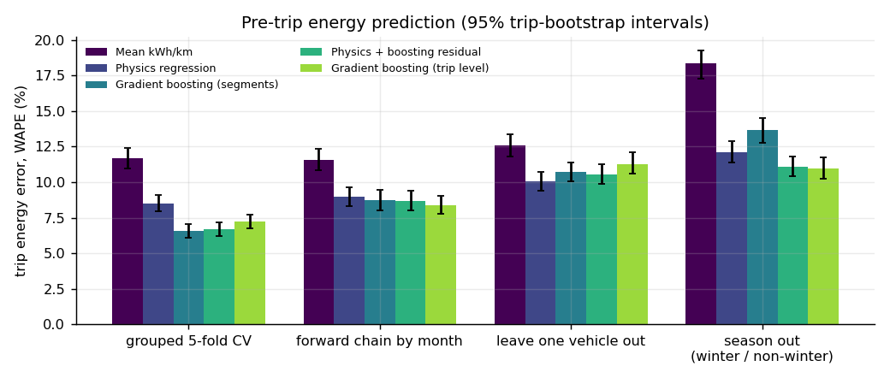
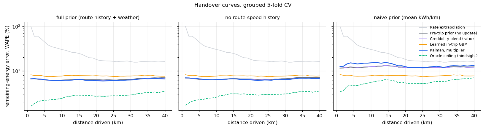
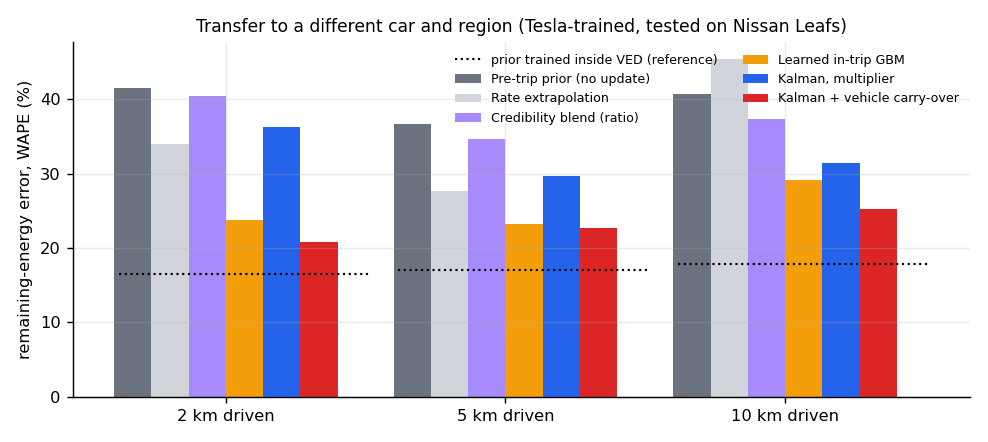
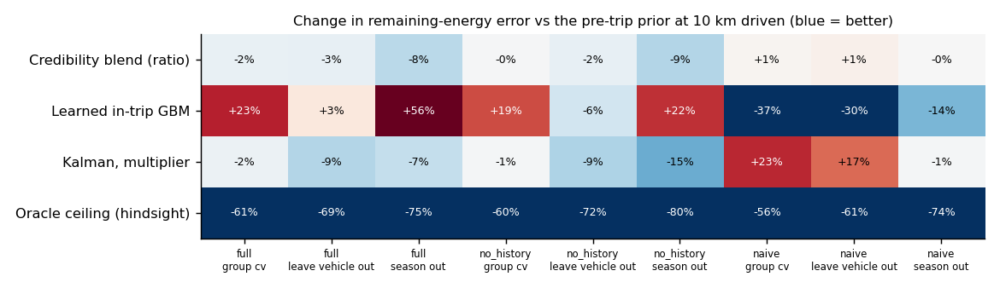
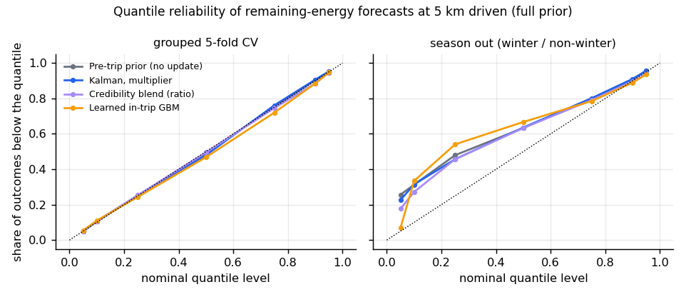
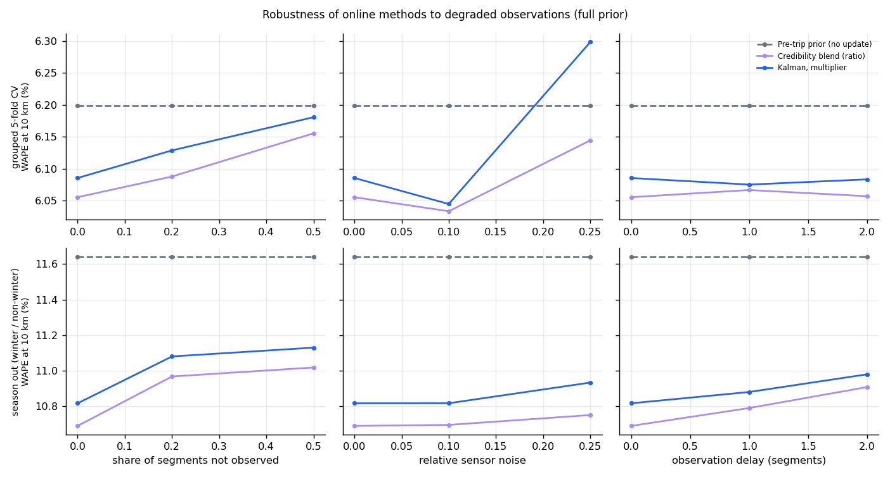
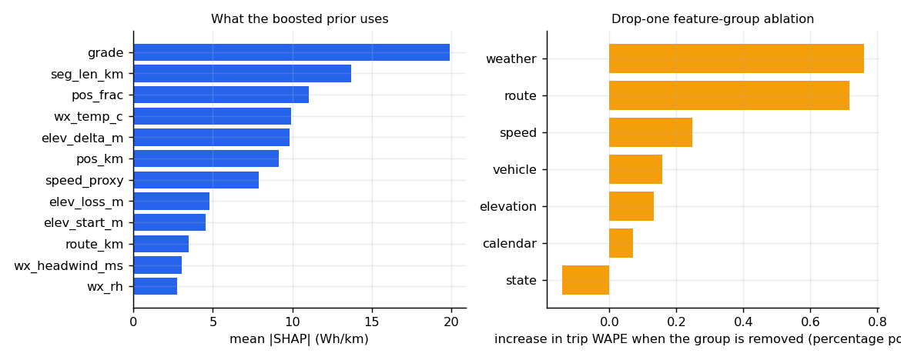
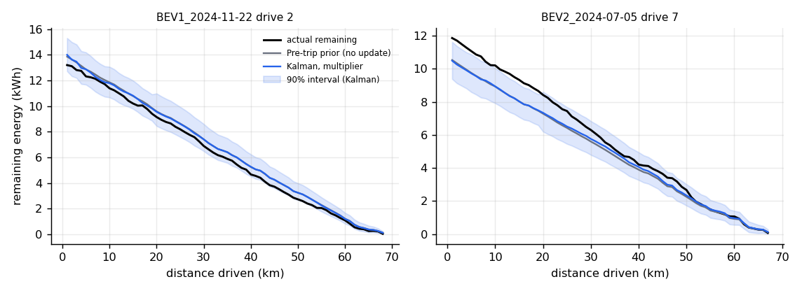

# Results report

Generated by `python -m evprior report` from `results/*.json` (config hash `4396ad152f6e`). Every number below is read from those files.

## 1. Data

Source: KU Leuven BEV energy-dynamics dataset (CC BY 4.0, DOI 10.48804/8KPDTW), 2 Tesla Model Y, 1 Hz CAN-derived signals. 1396 driving-session files; 1170 kept after quality filters (27,624 km, 4,913 kWh, median 186 Wh/km). Kept per vehicle: BEV1 327, BEV2 843.

Dropped: too_short_distance (163), too_short_duration (63).

Energy label = integral of pack voltage x current. Against the car's own energy counters it has a median ratio of 1.0018 and agrees within 5% on 99.0% of trips (trips with |counter energy| > 0.5 kWh). 10 sessions show negative counter energy (counter glitches), which is why the counters are used as a check, not as the label. BEV1 odometer unusable (values ~ -4.2e6); distance derived from speed integral, GPS used as check.

## 2. Pre-trip prediction (the prior)

Trip energy error as weighted absolute percentage error (WAPE = sum|error| / sum actual), with 95% intervals from a trip-level bootstrap. Features are pre-trip only (route geometry, SRTM elevation, archive weather, start state, calendar, vehicle, and a leakage-safe route-speed history); a unit test fails the build if any in-trip column enters the prior.

| model | grouped 5-fold CV | forward chain by month | leave one vehicle out | season out (winter / non-winter) |
|---|---|---|---|---|
| Mean kWh/km | 11.7% [11.0%, 12.4%] | 11.6% [10.9%, 12.4%] | 12.6% [11.8%, 13.4%] | 18.3% [17.3%, 19.2%] |
| Physics regression | 8.5% [8.0%, 9.1%] | 9.0% [8.3%, 9.6%] | 10.0% [9.4%, 10.7%] | 12.1% [11.4%, 12.9%] |
| Gradient boosting (segments) | 6.6% [6.1%, 7.1%] | 8.7% [8.0%, 9.4%] | 10.7% [10.0%, 11.4%] | 13.7% [12.8%, 14.5%] |
| Physics + boosting residual | 6.7% [6.2%, 7.2%] | 8.7% [8.0%, 9.4%] | 10.6% [9.9%, 11.3%] | 11.1% [10.4%, 11.8%] |
| Gradient boosting (trip level) | 7.2% [6.8%, 7.7%] | 8.4% [7.8%, 9.0%] | 11.3% [10.6%, 12.1%] | 11.0% [10.2%, 11.7%] |

Calibrated trip-level intervals for the main prior (`physics_gbm`; conformal on out-of-fold residuals). Nominal 80% and 90%:

| scheme | coverage of 80% interval | coverage of 90% interval | mean 90% width relative to forecast |
|---|---|---|---|
| grouped 5-fold CV | 81.2% | 90.0% | 47% |
| forward chain by month | 74.3% | 87.8% | 47% |
| leave one vehicle out | 63.9% | 77.6% | 48% |
| season out (winter / non-winter) | 70.2% | 83.2% | 49% |

## 3. Dynamic remaining-energy prediction

At a checkpoint after d km, every method forecasts the energy still to be used on the planned route. Error is WAPE of that remainder. The three prior-quality regimes show how much online adaptation is worth as the starting estimate gets worse. `Oracle ceiling` scales the nominal remainder by the trip's true overall consumption ratio. That ratio includes the very segments being forecast, so the oracle is close to tautological: it shows that most of the error is a single per-trip scale, not that an online method could reach it from the first few kilometres. It is not deployable and is not a target.

### grouped 5-fold CV

**Prior regime: full prior (route history + weather)**

| method | 2 km driven (n=1092) | 5 km driven (n=703) | 10 km driven (n=523) | 20 km driven (n=400) |
|---|---|---|---|---|
| Pre-trip prior (no update) | 6.6% [6.2%, 7.2%] | 6.3% [5.7%, 6.9%] | 6.2% [5.5%, 6.9%] | 6.3% [5.5%, 7.1%] |
| Rate extrapolation | 60.0% [55.7%, 64.4%] | 44.7% [41.2%, 48.1%] | 30.3% [27.6%, 33.4%] | 18.1% [16.4%, 20.0%] |
| Credibility blend (rate) | 6.7% [6.2%, 7.2%] | 6.3% [5.8%, 7.0%] | 6.3% [5.6%, 6.9%] | 6.3% [5.6%, 7.1%] |
| Credibility blend (ratio) | 6.6% [6.2%, 7.2%] | 6.3% [5.7%, 6.9%] | 6.1% [5.4%, 6.7%] | 6.0% [5.4%, 6.8%] |
| Learned in-trip GBM | 7.9% [7.2%, 8.5%] | 7.6% [6.9%, 8.3%] | 7.6% [6.9%, 8.3%] | 7.8% [7.0%, 8.6%] |
| Kalman, multiplier | 6.7% [6.2%, 7.2%] | 6.3% [5.8%, 6.9%] | 6.1% [5.5%, 6.7%] | 6.0% [5.3%, 6.8%] |
| Kalman, offset | 6.7% [6.2%, 7.2%] | 6.3% [5.7%, 6.9%] | 6.1% [5.4%, 6.7%] | 6.0% [5.3%, 6.8%] |
| Kalman, multiplier + offset | 6.7% [6.2%, 7.2%] | 6.3% [5.8%, 6.9%] | 6.1% [5.5%, 6.7%] | 6.0% [5.3%, 6.8%] |
| Kalman + vehicle carry-over | 6.8% [6.4%, 7.4%] | 6.5% [5.9%, 7.1%] | 6.2% [5.6%, 6.8%] | 6.1% [5.5%, 7.0%] |
| Oracle ceiling (hindsight) | 1.8% [1.7%, 2.0%] | 2.2% [2.0%, 2.4%] | 2.4% [2.2%, 2.7%] | 2.7% [2.4%, 3.0%] |

**Prior regime: no route-speed history**

| method | 2 km driven (n=1092) | 5 km driven (n=703) | 10 km driven (n=523) | 20 km driven (n=400) |
|---|---|---|---|---|
| Pre-trip prior (no update) | 6.9% [6.3%, 7.5%] | 6.5% [5.9%, 7.2%] | 6.4% [5.7%, 7.1%] | 6.5% [5.7%, 7.4%] |
| Rate extrapolation | 60.0% [55.7%, 64.4%] | 44.7% [41.2%, 48.1%] | 30.3% [27.6%, 33.4%] | 18.1% [16.4%, 20.0%] |
| Credibility blend (rate) | 6.9% [6.4%, 7.5%] | 6.5% [6.0%, 7.2%] | 6.5% [5.8%, 7.2%] | 6.6% [5.8%, 7.5%] |
| Credibility blend (ratio) | 6.9% [6.4%, 7.5%] | 6.5% [5.9%, 7.2%] | 6.4% [5.7%, 7.0%] | 6.4% [5.7%, 7.2%] |
| Learned in-trip GBM | 7.9% [7.3%, 8.5%] | 7.6% [7.0%, 8.3%] | 7.6% [6.9%, 8.3%] | 7.7% [6.9%, 8.5%] |
| Kalman, multiplier | 6.9% [6.4%, 7.5%] | 6.6% [6.1%, 7.2%] | 6.3% [5.7%, 6.9%] | 6.3% [5.6%, 7.0%] |
| Kalman, offset | 6.9% [6.4%, 7.5%] | 6.6% [6.0%, 7.2%] | 6.3% [5.7%, 7.0%] | 6.3% [5.6%, 7.1%] |
| Kalman, multiplier + offset | 6.9% [6.4%, 7.5%] | 6.6% [6.1%, 7.2%] | 6.3% [5.7%, 6.9%] | 6.3% [5.6%, 7.0%] |
| Kalman + vehicle carry-over | 7.1% [6.6%, 7.7%] | 6.8% [6.2%, 7.4%] | 6.4% [5.7%, 7.1%] | 6.4% [5.7%, 7.2%] |
| Oracle ceiling (hindsight) | 1.9% [1.7%, 2.1%] | 2.2% [2.0%, 2.4%] | 2.6% [2.3%, 2.8%] | 2.9% [2.6%, 3.3%] |

**Prior regime: naive prior (mean kWh/km)**

| method | 2 km driven (n=1092) | 5 km driven (n=703) | 10 km driven (n=523) | 20 km driven (n=400) |
|---|---|---|---|---|
| Pre-trip prior (no update) | 11.6% [10.8%, 12.6%] | 12.1% [11.1%, 13.1%] | 12.4% [11.4%, 13.5%] | 12.0% [10.9%, 13.3%] |
| Rate extrapolation | 60.0% [55.7%, 64.4%] | 44.7% [41.2%, 48.1%] | 30.3% [27.6%, 33.4%] | 18.1% [16.4%, 20.0%] |
| Credibility blend (rate) | 11.7% [10.8%, 12.6%] | 12.2% [11.2%, 13.2%] | 12.5% [11.5%, 13.6%] | 11.9% [10.7%, 13.2%] |
| Credibility blend (ratio) | 11.7% [10.8%, 12.6%] | 12.2% [11.2%, 13.2%] | 12.5% [11.5%, 13.6%] | 11.9% [10.7%, 13.2%] |
| Learned in-trip GBM | 7.9% [7.3%, 8.6%] | 7.6% [7.0%, 8.3%] | 7.8% [7.1%, 8.5%] | 7.8% [7.0%, 8.7%] |
| Kalman, multiplier | 12.7% [11.7%, 13.7%] | 14.8% [13.7%, 16.0%] | 15.2% [13.9%, 16.6%] | 12.4% [11.1%, 13.7%] |
| Kalman, offset | 12.7% [11.7%, 13.7%] | 14.8% [13.7%, 16.0%] | 15.2% [13.9%, 16.6%] | 12.4% [11.1%, 13.7%] |
| Kalman, multiplier + offset | 12.7% [11.7%, 13.7%] | 14.8% [13.7%, 16.0%] | 15.2% [13.9%, 16.6%] | 12.4% [11.1%, 13.8%] |
| Kalman + vehicle carry-over | 11.2% [10.3%, 12.0%] | 13.4% [12.4%, 14.4%] | 13.9% [12.7%, 15.2%] | 11.9% [10.9%, 13.1%] |
| Oracle ceiling (hindsight) | 3.6% [3.3%, 4.0%] | 4.6% [4.2%, 5.0%] | 5.5% [5.0%, 6.0%] | 5.4% [4.8%, 6.0%] |

### leave one vehicle out

**Prior regime: full prior (route history + weather)**

| method | 2 km driven (n=1092) | 5 km driven (n=703) | 10 km driven (n=523) | 20 km driven (n=400) |
|---|---|---|---|---|
| Pre-trip prior (no update) | 10.4% [9.7%, 11.1%] | 9.8% [9.0%, 10.6%] | 9.4% [8.6%, 10.3%] | 9.8% [8.9%, 10.8%] |
| Rate extrapolation | 60.0% [55.8%, 64.5%] | 44.7% [41.5%, 48.1%] | 30.3% [27.7%, 33.1%] | 18.1% [16.3%, 20.0%] |
| Credibility blend (rate) | 10.4% [9.6%, 11.0%] | 9.8% [9.0%, 10.6%] | 9.3% [8.5%, 10.2%] | 9.6% [8.7%, 10.6%] |
| Credibility blend (ratio) | 10.3% [9.6%, 11.0%] | 9.7% [8.9%, 10.5%] | 9.2% [8.4%, 10.0%] | 9.5% [8.6%, 10.4%] |
| Learned in-trip GBM | 10.7% [9.9%, 11.5%] | 10.2% [9.4%, 11.1%] | 9.7% [8.9%, 10.6%] | 9.7% [8.7%, 10.9%] |
| Kalman, multiplier | 9.9% [9.2%, 10.5%] | 9.3% [8.6%, 10.1%] | 8.6% [7.9%, 9.3%] | 8.7% [7.8%, 9.6%] |
| Kalman, offset | 10.2% [9.4%, 10.8%] | 9.5% [8.8%, 10.3%] | 8.8% [8.0%, 9.6%] | 8.8% [8.0%, 9.8%] |
| Kalman, multiplier + offset | 10.0% [9.2%, 10.6%] | 9.3% [8.6%, 10.1%] | 8.7% [7.9%, 9.4%] | 8.7% [7.8%, 9.6%] |
| Kalman + vehicle carry-over | 9.0% [8.3%, 9.6%] | 8.6% [8.0%, 9.3%] | 8.1% [7.4%, 8.8%] | 8.1% [7.3%, 9.0%] |
| Oracle ceiling (hindsight) | 2.6% [2.3%, 2.8%] | 2.7% [2.5%, 3.0%] | 2.9% [2.6%, 3.2%] | 3.4% [3.1%, 3.9%] |

**Prior regime: no route-speed history**

| method | 2 km driven (n=1092) | 5 km driven (n=703) | 10 km driven (n=523) | 20 km driven (n=400) |
|---|---|---|---|---|
| Pre-trip prior (no update) | 11.2% [10.4%, 12.0%] | 10.7% [9.8%, 11.5%] | 10.4% [9.5%, 11.4%] | 10.9% [9.8%, 12.1%] |
| Rate extrapolation | 60.0% [55.8%, 64.5%] | 44.7% [41.5%, 48.1%] | 30.3% [27.7%, 33.1%] | 18.1% [16.3%, 20.0%] |
| Credibility blend (rate) | 11.2% [10.4%, 12.0%] | 10.6% [9.8%, 11.5%] | 10.4% [9.4%, 11.3%] | 10.7% [9.7%, 11.9%] |
| Credibility blend (ratio) | 11.2% [10.3%, 11.9%] | 10.5% [9.7%, 11.4%] | 10.2% [9.3%, 11.1%] | 10.5% [9.5%, 11.7%] |
| Learned in-trip GBM | 10.9% [10.0%, 11.7%] | 10.3% [9.5%, 11.2%] | 9.8% [9.0%, 10.8%] | 9.8% [8.8%, 11.0%] |
| Kalman, multiplier | 10.7% [9.9%, 11.4%] | 10.0% [9.2%, 10.8%] | 9.5% [8.7%, 10.4%] | 9.6% [8.7%, 10.6%] |
| Kalman, offset | 11.0% [10.2%, 11.8%] | 10.3% [9.5%, 11.2%] | 9.8% [8.9%, 10.7%] | 9.9% [8.9%, 11.0%] |
| Kalman, multiplier + offset | 10.8% [10.0%, 11.5%] | 10.1% [9.3%, 10.9%] | 9.6% [8.8%, 10.5%] | 9.6% [8.7%, 10.6%] |
| Kalman + vehicle carry-over | 9.5% [8.8%, 10.2%] | 9.0% [8.3%, 9.8%] | 8.7% [7.9%, 9.4%] | 8.7% [7.9%, 9.7%] |
| Oracle ceiling (hindsight) | 2.6% [2.4%, 2.9%] | 2.7% [2.4%, 3.0%] | 2.9% [2.7%, 3.2%] | 3.4% [3.1%, 3.8%] |

**Prior regime: naive prior (mean kWh/km)**

| method | 2 km driven (n=1092) | 5 km driven (n=703) | 10 km driven (n=523) | 20 km driven (n=400) |
|---|---|---|---|---|
| Pre-trip prior (no update) | 12.8% [12.0%, 13.8%] | 13.5% [12.5%, 14.7%] | 13.9% [12.7%, 15.1%] | 13.6% [12.3%, 15.2%] |
| Rate extrapolation | 60.0% [55.8%, 64.5%] | 44.7% [41.5%, 48.1%] | 30.3% [27.7%, 33.1%] | 18.1% [16.3%, 20.0%] |
| Credibility blend (rate) | 12.9% [12.0%, 13.9%] | 13.8% [12.7%, 14.9%] | 14.1% [12.9%, 15.3%] | 13.5% [12.2%, 15.0%] |
| Credibility blend (ratio) | 12.9% [12.0%, 13.9%] | 13.8% [12.7%, 14.9%] | 14.1% [12.9%, 15.3%] | 13.5% [12.2%, 15.0%] |
| Learned in-trip GBM | 10.7% [9.9%, 11.6%] | 10.2% [9.4%, 11.2%] | 9.7% [8.8%, 10.6%] | 9.6% [8.6%, 10.8%] |
| Kalman, multiplier | 14.0% [13.0%, 15.0%] | 16.1% [15.0%, 17.6%] | 16.3% [15.0%, 17.6%] | 13.3% [12.0%, 14.8%] |
| Kalman, offset | 14.0% [13.0%, 15.0%] | 16.1% [15.0%, 17.6%] | 16.3% [15.0%, 17.6%] | 13.3% [12.0%, 14.8%] |
| Kalman, multiplier + offset | 14.0% [13.0%, 15.0%] | 16.1% [15.0%, 17.6%] | 16.3% [15.0%, 17.6%] | 13.3% [12.0%, 14.8%] |
| Kalman + vehicle carry-over | 10.9% [10.1%, 11.7%] | 13.1% [12.1%, 14.1%] | 13.6% [12.4%, 14.8%] | 11.8% [10.7%, 13.1%] |
| Oracle ceiling (hindsight) | 3.6% [3.3%, 4.0%] | 4.6% [4.2%, 5.1%] | 5.5% [5.0%, 6.0%] | 5.4% [4.8%, 6.0%] |

### season out (winter / non-winter)

**Prior regime: full prior (route history + weather)**

| method | 2 km driven (n=1092) | 5 km driven (n=703) | 10 km driven (n=523) | 20 km driven (n=400) |
|---|---|---|---|---|
| Pre-trip prior (no update) | 11.4% [10.7%, 12.1%] | 11.7% [10.9%, 12.5%] | 11.6% [10.8%, 12.5%] | 11.6% [10.6%, 12.6%] |
| Rate extrapolation | 60.0% [55.5%, 65.2%] | 44.7% [41.2%, 48.3%] | 30.3% [27.7%, 33.0%] | 18.1% [16.2%, 20.1%] |
| Credibility blend (rate) | 11.8% [11.1%, 12.5%] | 12.4% [11.6%, 13.3%] | 12.4% [11.5%, 13.4%] | 11.8% [10.7%, 12.8%] |
| Credibility blend (ratio) | 11.2% [10.5%, 11.9%] | 11.4% [10.6%, 12.3%] | 10.7% [9.9%, 11.6%] | 9.2% [8.3%, 10.2%] |
| Learned in-trip GBM | 17.0% [15.8%, 18.4%] | 17.9% [16.5%, 19.4%] | 18.2% [16.6%, 19.7%] | 18.2% [16.2%, 20.0%] |
| Kalman, multiplier | 11.1% [10.4%, 11.8%] | 11.4% [10.6%, 12.2%] | 10.8% [10.0%, 11.7%] | 9.6% [8.6%, 10.6%] |
| Kalman, offset | 11.2% [10.4%, 11.9%] | 11.4% [10.6%, 12.2%] | 10.7% [9.8%, 11.6%] | 9.2% [8.3%, 10.2%] |
| Kalman, multiplier + offset | 11.1% [10.4%, 11.8%] | 11.4% [10.5%, 12.2%] | 10.7% [9.9%, 11.6%] | 9.4% [8.4%, 10.3%] |
| Kalman + vehicle carry-over | 7.8% [7.3%, 8.4%] | 8.1% [7.5%, 8.7%] | 7.8% [7.1%, 8.5%] | 7.6% [6.8%, 8.4%] |
| Oracle ceiling (hindsight) | 2.0% [1.8%, 2.2%] | 2.5% [2.3%, 2.8%] | 2.9% [2.6%, 3.2%] | 3.2% [2.9%, 3.6%] |

**Prior regime: no route-speed history**

| method | 2 km driven (n=1092) | 5 km driven (n=703) | 10 km driven (n=523) | 20 km driven (n=400) |
|---|---|---|---|---|
| Pre-trip prior (no update) | 14.9% [14.0%, 15.9%] | 15.3% [14.3%, 16.4%] | 15.3% [14.2%, 16.5%] | 15.2% [13.8%, 16.5%] |
| Rate extrapolation | 60.0% [55.5%, 65.2%] | 44.7% [41.2%, 48.3%] | 30.3% [27.7%, 33.0%] | 18.1% [16.2%, 20.1%] |
| Credibility blend (rate) | 15.1% [14.2%, 16.0%] | 15.6% [14.5%, 16.7%] | 15.6% [14.4%, 16.8%] | 15.0% [13.6%, 16.3%] |
| Credibility blend (ratio) | 14.6% [13.7%, 15.6%] | 14.8% [13.7%, 15.9%] | 14.0% [12.9%, 15.1%] | 12.3% [11.0%, 13.6%] |
| Learned in-trip GBM | 17.5% [16.2%, 18.9%] | 18.3% [16.8%, 19.9%] | 18.7% [17.1%, 20.2%] | 18.8% [16.7%, 20.6%] |
| Kalman, multiplier | 14.1% [13.2%, 15.1%] | 14.2% [13.2%, 15.4%] | 13.1% [12.0%, 14.2%] | 11.0% [9.7%, 12.3%] |
| Kalman, offset | 14.4% [13.5%, 15.3%] | 14.4% [13.4%, 15.6%] | 13.2% [12.1%, 14.3%] | 10.8% [9.6%, 12.1%] |
| Kalman, multiplier + offset | 14.1% [13.2%, 15.1%] | 14.2% [13.1%, 15.4%] | 12.9% [11.8%, 14.1%] | 10.7% [9.4%, 12.0%] |
| Kalman + vehicle carry-over | 8.5% [7.9%, 9.1%] | 8.7% [8.1%, 9.4%] | 8.3% [7.6%, 9.1%] | 8.2% [7.4%, 9.0%] |
| Oracle ceiling (hindsight) | 2.1% [1.9%, 2.3%] | 2.7% [2.4%, 2.9%] | 3.1% [2.8%, 3.4%] | 3.4% [3.1%, 3.8%] |

**Prior regime: naive prior (mean kWh/km)**

| method | 2 km driven (n=1092) | 5 km driven (n=703) | 10 km driven (n=523) | 20 km driven (n=400) |
|---|---|---|---|---|
| Pre-trip prior (no update) | 19.5% [18.4%, 20.7%] | 20.6% [19.4%, 21.9%] | 21.2% [19.8%, 22.8%] | 20.8% [19.2%, 22.6%] |
| Rate extrapolation | 60.0% [55.5%, 65.2%] | 44.7% [41.2%, 48.3%] | 30.3% [27.7%, 33.0%] | 18.1% [16.2%, 20.1%] |
| Credibility blend (rate) | 19.6% [18.5%, 20.7%] | 20.6% [19.4%, 22.0%] | 21.2% [19.7%, 22.7%] | 20.4% [18.8%, 22.2%] |
| Credibility blend (ratio) | 19.6% [18.5%, 20.7%] | 20.6% [19.4%, 22.0%] | 21.2% [19.7%, 22.7%] | 20.4% [18.8%, 22.2%] |
| Learned in-trip GBM | 16.9% [15.7%, 18.2%] | 18.1% [16.7%, 19.6%] | 18.3% [16.8%, 19.8%] | 17.9% [15.9%, 19.7%] |
| Kalman, multiplier | 19.8% [18.7%, 21.1%] | 21.1% [19.8%, 22.6%] | 21.1% [19.6%, 22.8%] | 18.4% [16.7%, 20.2%] |
| Kalman, offset | 19.8% [18.7%, 21.1%] | 21.1% [19.8%, 22.6%] | 21.1% [19.6%, 22.8%] | 18.4% [16.8%, 20.2%] |
| Kalman, multiplier + offset | 19.8% [18.7%, 21.1%] | 21.1% [19.8%, 22.6%] | 21.1% [19.6%, 22.8%] | 18.4% [16.7%, 20.2%] |
| Kalman + vehicle carry-over | 10.7% [10.1%, 11.5%] | 11.8% [11.1%, 12.7%] | 12.3% [11.4%, 13.3%] | 11.2% [10.2%, 12.4%] |
| Oracle ceiling (hindsight) | 3.6% [3.3%, 4.0%] | 4.6% [4.3%, 5.1%] | 5.5% [5.0%, 6.0%] | 5.4% [4.8%, 6.0%] |

### forward chain by month

**Prior regime: full prior (route history + weather)**

| method | 2 km driven (n=930) | 5 km driven (n=593) | 10 km driven (n=450) | 20 km driven (n=346) |
|---|---|---|---|---|
| Pre-trip prior (no update) | 8.6% [7.9%, 9.4%] | 8.3% [7.5%, 9.2%] | 8.4% [7.5%, 9.3%] | 8.5% [7.3%, 9.8%] |
| Rate extrapolation | 61.1% [56.4%, 66.0%] | 44.0% [40.3%, 47.6%] | 30.1% [27.3%, 33.1%] | 17.8% [15.9%, 20.0%] |
| Credibility blend (rate) | 8.6% [7.9%, 9.4%] | 8.4% [7.5%, 9.2%] | 8.4% [7.5%, 9.3%] | 8.4% [7.3%, 9.5%] |
| Credibility blend (ratio) | 8.5% [7.8%, 9.3%] | 8.2% [7.3%, 9.1%] | 8.2% [7.3%, 9.1%] | 8.1% [7.0%, 9.3%] |
| Learned in-trip GBM | 8.3% [7.5%, 9.0%] | 7.9% [7.1%, 8.7%] | 7.9% [7.0%, 8.9%] | 8.1% [7.0%, 9.2%] |
| Kalman, multiplier | 8.4% [7.7%, 9.1%] | 7.9% [7.1%, 8.7%] | 7.9% [6.9%, 8.8%] | 7.5% [6.4%, 8.8%] |
| Kalman, offset | 8.5% [7.8%, 9.3%] | 8.1% [7.2%, 8.9%] | 8.0% [7.1%, 9.0%] | 7.6% [6.5%, 8.8%] |
| Kalman, multiplier + offset | 8.4% [7.7%, 9.2%] | 8.0% [7.2%, 8.9%] | 8.0% [7.1%, 8.9%] | 7.6% [6.5%, 8.8%] |
| Kalman + vehicle carry-over | 7.8% [7.2%, 8.5%] | 7.5% [6.7%, 8.1%] | 7.4% [6.6%, 8.2%] | 7.1% [6.2%, 8.2%] |
| Oracle ceiling (hindsight) | 1.9% [1.7%, 2.1%] | 2.1% [1.9%, 2.3%] | 2.5% [2.3%, 2.8%] | 2.8% [2.5%, 3.2%] |

**Prior regime: no route-speed history**

| method | 2 km driven (n=930) | 5 km driven (n=593) | 10 km driven (n=450) | 20 km driven (n=346) |
|---|---|---|---|---|
| Pre-trip prior (no update) | 9.3% [8.5%, 10.1%] | 9.0% [8.2%, 9.9%] | 9.0% [8.1%, 9.9%] | 9.4% [8.3%, 10.5%] |
| Rate extrapolation | 61.1% [56.4%, 66.0%] | 44.0% [40.3%, 47.6%] | 30.1% [27.3%, 33.1%] | 17.8% [15.9%, 20.0%] |
| Credibility blend (rate) | 9.3% [8.6%, 10.1%] | 9.1% [8.3%, 10.0%] | 9.1% [8.2%, 10.0%] | 9.3% [8.3%, 10.4%] |
| Credibility blend (ratio) | 9.2% [8.5%, 10.0%] | 8.9% [8.0%, 9.8%] | 8.8% [7.8%, 9.6%] | 8.8% [7.7%, 10.0%] |
| Learned in-trip GBM | 8.3% [7.5%, 9.0%] | 7.9% [7.1%, 8.8%] | 7.8% [7.0%, 8.8%] | 8.0% [6.9%, 9.1%] |
| Kalman, multiplier | 9.1% [8.4%, 9.8%] | 8.7% [7.8%, 9.5%] | 8.4% [7.5%, 9.3%] | 8.3% [7.3%, 9.5%] |
| Kalman, offset | 9.1% [8.4%, 9.9%] | 8.8% [7.9%, 9.7%] | 8.6% [7.6%, 9.5%] | 8.5% [7.4%, 9.6%] |
| Kalman, multiplier + offset | 9.1% [8.4%, 9.9%] | 8.7% [7.9%, 9.6%] | 8.4% [7.5%, 9.3%] | 8.3% [7.3%, 9.5%] |
| Kalman + vehicle carry-over | 8.4% [7.7%, 9.2%] | 8.1% [7.3%, 8.8%] | 7.8% [7.0%, 8.6%] | 7.8% [6.9%, 8.8%] |
| Oracle ceiling (hindsight) | 1.9% [1.7%, 2.1%] | 2.3% [2.1%, 2.5%] | 2.7% [2.4%, 3.0%] | 3.1% [2.8%, 3.5%] |

**Prior regime: naive prior (mean kWh/km)**

| method | 2 km driven (n=930) | 5 km driven (n=593) | 10 km driven (n=450) | 20 km driven (n=346) |
|---|---|---|---|---|
| Pre-trip prior (no update) | 10.5% [9.7%, 11.4%] | 10.2% [9.3%, 11.1%] | 10.3% [9.4%, 11.3%] | 10.3% [9.2%, 11.4%] |
| Rate extrapolation | 61.1% [56.4%, 66.0%] | 44.0% [40.3%, 47.6%] | 30.1% [27.3%, 33.1%] | 17.8% [15.9%, 20.0%] |
| Credibility blend (rate) | 10.5% [9.7%, 11.3%] | 10.1% [9.2%, 11.0%] | 10.2% [9.3%, 11.2%] | 10.1% [9.0%, 11.2%] |
| Credibility blend (ratio) | 10.5% [9.7%, 11.3%] | 10.1% [9.2%, 11.0%] | 10.2% [9.3%, 11.2%] | 10.1% [9.0%, 11.2%] |
| Learned in-trip GBM | 8.3% [7.6%, 9.1%] | 8.0% [7.2%, 8.8%] | 7.9% [7.0%, 8.8%] | 8.0% [6.9%, 9.1%] |
| Kalman, multiplier | 10.3% [9.5%, 11.1%] | 10.0% [9.1%, 10.9%] | 10.1% [9.1%, 11.1%] | 9.5% [8.5%, 10.5%] |
| Kalman, offset | 10.2% [9.5%, 11.1%] | 9.9% [9.1%, 10.9%] | 10.1% [9.1%, 11.1%] | 9.4% [8.4%, 10.5%] |
| Kalman, multiplier + offset | 10.2% [9.5%, 11.1%] | 9.9% [9.1%, 10.9%] | 10.1% [9.1%, 11.1%] | 9.4% [8.4%, 10.5%] |
| Kalman + vehicle carry-over | 10.6% [9.8%, 11.3%] | 11.2% [10.4%, 12.1%] | 11.6% [10.7%, 12.6%] | 10.5% [9.5%, 11.5%] |
| Oracle ceiling (hindsight) | 3.6% [3.3%, 3.9%] | 4.5% [4.0%, 4.9%] | 5.3% [4.9%, 5.9%] | 5.1% [4.6%, 5.8%] |

### External validation: a different car in a different region

The Vehicle Energy Dataset (Ann Arbor, Michigan, Apache-2.0) contains three Nissan Leaf BEVs: 341 usable trips (2,063 km, median 147 Wh/km, versus 186 Wh/km for the Teslas). Trip energy is the integral of -V x I (VED reports discharge as negative current) and correlates 0.82 with the trip's SOC drop; the implied pack capacity is 16 kWh (IQR 13 to 19), the same order as the 24 kWh nominal pack of a used 2013 Leaf. That is a plausibility check, not a calibration. VED has no battery temperature (ambient stands in) and its GPS is privacy-processed (distance comes from the speed integral).

**Transfer** trains everything (prior, filter parameters, calibration, learned in-trip model) on the KU Leuven trips only and tests on every Leaf trip; vehicle identity is dropped from the features. **Kalman + vehicle carry-over** starts each trip from the energy-weighted consumption ratio of the same vehicle's earlier, already-finished trips (30-day half-life, shrunk towards 1), which uses no future information. 'Within VED' is the in-domain reference (grouped CV inside VED).

**external: train on KU Leuven Teslas, test on VED Leafs, prior regime: no route-speed history**

| method | 1 km driven (n=341) | 2 km driven (n=329) | 5 km driven (n=168) | 10 km driven (n=50) |
|---|---|---|---|---|
| Pre-trip prior (no update) | 44.5% (bias +40%) | 41.5% (bias +37%) | 36.7% (bias +31%) | 40.7% (bias +38%) |
| Rate extrapolation | 43.2% (bias +21%) | 34.0% (bias +13%) | 27.7% (bias +7%) | 45.4% (bias +40%) |
| Credibility blend (rate) | 44.5% (bias +40%) | 41.4% (bias +37%) | 36.4% (bias +31%) | 40.7% (bias +38%) |
| Credibility blend (ratio) | 43.9% (bias +39%) | 40.4% (bias +36%) | 34.7% (bias +29%) | 37.4% (bias +34%) |
| Learned in-trip GBM | 24.3% (bias +13%) | 23.8% (bias +13%) | 23.3% (bias +16%) | 29.1% (bias +24%) |
| Kalman, multiplier | 40.1% (bias +35%) | 36.2% (bias +31%) | 29.7% (bias +23%) | 31.4% (bias +27%) |
| Kalman, offset | 43.4% (bias +39%) | 39.9% (bias +35%) | 33.9% (bias +28%) | 35.6% (bias +32%) |
| Kalman, multiplier + offset | 40.1% (bias +35%) | 36.2% (bias +31%) | 29.7% (bias +23%) | 31.4% (bias +27%) |
| Kalman + vehicle carry-over | 19.4% (bias -8%) | 20.8% (bias -11%) | 22.8% (bias -18%) | 25.2% (bias -14%) |
| Oracle ceiling (hindsight) | 14.0% (bias -14%) | 15.3% (bias -14%) | 18.3% (bias -16%) | 19.0% (bias -8%) |

**external: train on KU Leuven Teslas, test on VED Leafs, prior regime: naive prior (mean kWh/km)**

| method | 1 km driven (n=341) | 2 km driven (n=329) | 5 km driven (n=168) | 10 km driven (n=50) |
|---|---|---|---|---|
| Pre-trip prior (no update) | 32.3% (bias +16%) | 33.4% (bias +18%) | 31.5% (bias +22%) | 55.6% (bias +52%) |
| Rate extrapolation | 43.2% (bias +21%) | 34.0% (bias +13%) | 27.7% (bias +7%) | 45.4% (bias +40%) |
| Credibility blend (rate) | 32.3% (bias +16%) | 33.3% (bias +18%) | 31.3% (bias +22%) | 55.2% (bias +52%) |
| Credibility blend (ratio) | 32.3% (bias +16%) | 33.3% (bias +18%) | 31.3% (bias +22%) | 55.2% (bias +52%) |
| Learned in-trip GBM | 23.2% (bias +12%) | 23.0% (bias +12%) | 22.7% (bias +15%) | 28.8% (bias +23%) |
| Kalman, multiplier | 31.8% (bias +16%) | 31.9% (bias +17%) | 28.1% (bias +19%) | 50.4% (bias +49%) |
| Kalman, offset | 31.8% (bias +16%) | 31.9% (bias +17%) | 28.2% (bias +19%) | 50.4% (bias +49%) |
| Kalman, multiplier + offset | 31.8% (bias +16%) | 31.9% (bias +17%) | 28.2% (bias +19%) | 50.4% (bias +49%) |
| Kalman + vehicle carry-over | 22.1% (bias +8%) | 22.4% (bias +8%) | 19.3% (bias +7%) | 35.7% (bias +33%) |
| Oracle ceiling (hindsight) | 7.0% (bias +2%) | 10.2% (bias +3%) | 13.7% (bias +3%) | 32.9% (bias +29%) |

**external: grouped CV inside VED, prior regime: no route-speed history**

| method | 1 km driven (n=341) | 2 km driven (n=329) | 5 km driven (n=168) | 10 km driven (n=50) |
|---|---|---|---|---|
| Pre-trip prior (no update) | 15.3% (bias +1%) | 16.6% (bias +2%) | 17.0% (bias +3%) | 17.9% (bias +7%) |
| Rate extrapolation | 43.2% (bias +21%) | 34.0% (bias +13%) | 27.7% (bias +7%) | 45.4% (bias +40%) |
| Credibility blend (rate) | 15.4% (bias +2%) | 16.5% (bias +3%) | 16.5% (bias +3%) | 21.6% (bias +16%) |
| Credibility blend (ratio) | 15.2% (bias +2%) | 16.6% (bias +2%) | 16.3% (bias +2%) | 17.6% (bias +6%) |
| Learned in-trip GBM | 15.0% (bias +1%) | 15.8% (bias +1%) | 15.4% (bias +1%) | 17.0% (bias +7%) |
| Kalman, multiplier | 15.3% (bias +2%) | 16.4% (bias +2%) | 16.4% (bias +2%) | 17.6% (bias +5%) |
| Kalman, offset | 15.5% (bias +2%) | 16.7% (bias +2%) | 16.5% (bias +2%) | 19.1% (bias +6%) |
| Kalman, multiplier + offset | 15.4% (bias +2%) | 16.6% (bias +2%) | 16.5% (bias +2%) | 18.2% (bias +6%) |
| Kalman + vehicle carry-over | 15.4% (bias +1%) | 16.6% (bias +2%) | 16.0% (bias +1%) | 17.5% (bias +5%) |
| Oracle ceiling (hindsight) | 5.1% (bias +0%) | 7.8% (bias +1%) | 10.2% (bias +0%) | 16.1% (bias +4%) |

**external: grouped CV inside VED, prior regime: naive prior (mean kWh/km)**

| method | 1 km driven (n=341) | 2 km driven (n=329) | 5 km driven (n=168) | 10 km driven (n=50) |
|---|---|---|---|---|
| Pre-trip prior (no update) | 27.0% (bias +3%) | 28.3% (bias +4%) | 24.2% (bias +8%) | 42.0% (bias +36%) |
| Rate extrapolation | 43.2% (bias +21%) | 34.0% (bias +13%) | 27.7% (bias +7%) | 45.4% (bias +40%) |
| Credibility blend (rate) | 25.5% (bias +6%) | 25.6% (bias +7%) | 21.0% (bias +8%) | 41.7% (bias +39%) |
| Credibility blend (ratio) | 25.5% (bias +6%) | 25.6% (bias +7%) | 21.0% (bias +8%) | 41.7% (bias +39%) |
| Learned in-trip GBM | 15.4% (bias +1%) | 16.0% (bias +1%) | 15.5% (bias +1%) | 18.7% (bias +8%) |
| Kalman, multiplier | 26.3% (bias +9%) | 25.8% (bias +8%) | 23.1% (bias +7%) | 43.2% (bias +39%) |
| Kalman, offset | 26.2% (bias +9%) | 25.8% (bias +8%) | 23.1% (bias +8%) | 43.3% (bias +40%) |
| Kalman, multiplier + offset | 26.2% (bias +9%) | 25.8% (bias +8%) | 23.1% (bias +7%) | 43.1% (bias +39%) |
| Kalman + vehicle carry-over | 24.5% (bias +8%) | 24.5% (bias +8%) | 22.9% (bias +7%) | 42.5% (bias +39%) |
| Oracle ceiling (hindsight) | 7.1% (bias +2%) | 10.3% (bias +3%) | 13.7% (bias +3%) | 32.9% (bias +29%) |

### Handover points

First distance at which a method's remaining-energy error is lower than the static pre-trip prior with the paired trip-bootstrap 95% interval entirely below zero ("never" = not within 40 km).

| prior regime | scheme | Kalman multiplier | Kalman mult.+offset | credibility blend (ratio) | learned in-trip GBM |
|---|---|---|---|---|---|
| full prior (route history + weather) | grouped 5-fold CV | never | never | never | never |
| full prior (route history + weather) | leave one vehicle out | 1 km | 1 km | 1 km | never |
| full prior (route history + weather) | season out (winter / non-winter) | 2 km | 2 km | 2 km | never |
| no route-speed history | grouped 5-fold CV | never | never | never | never |
| no route-speed history | leave one vehicle out | 1 km | 1 km | 1 km | 15 km |
| no route-speed history | season out (winter / non-winter) | 1 km | 1 km | 1 km | never |
| naive prior (mean kWh/km) | grouped 5-fold CV | never | never | 31 km | 1 km |
| naive prior (mean kWh/km) | leave one vehicle out | never | never | 20 km | 1 km |
| naive prior (mean kWh/km) | season out (winter / non-winter) | 13 km | 13 km | 12 km | 1 km |

## 4. Uncertainty and decisions

Interval coverage (nominal 90%) and sharpness at 5 km driven, full prior. 'Conformal' uses held-out standardised residuals from training trips; 'Gaussian' uses the model's own variance.

**grouped 5-fold CV**

| method | 90% coverage (conformal) | mean 90% width (kWh) | 90% coverage (Gaussian) | CRPS (kWh) | reserve for 95% assurance (kWh) | arrive-below-reserve rate at fixed 3 kWh reserve |
|---|---|---|---|---|---|---|
| Pre-trip prior (no update) | 89.5% | 1.36 | 93.0% | 0.201 | 0.73 | 0.3% |
| Kalman, multiplier | 90.5% | 1.37 | 92.9% | 0.202 | 0.71 | 0.4% |
| Kalman, multiplier + offset | 90.3% | 1.37 | 92.9% | 0.202 | 0.71 | 0.4% |
| Credibility blend (ratio) | 89.6% | 1.96 | 84.2% | 0.207 | 0.72 | 0.4% |
| Learned in-trip GBM | 89.3% | 2.04 | 86.3% | 0.243 | 0.99 | 0.6% |

**season out (winter / non-winter)**

| method | 90% coverage (conformal) | mean 90% width (kWh) | 90% coverage (Gaussian) | CRPS (kWh) | reserve for 95% assurance (kWh) | arrive-below-reserve rate at fixed 3 kWh reserve |
|---|---|---|---|---|---|---|
| Pre-trip prior (no update) | 70.1% | 1.48 | 81.9% | 0.381 | 0.45 | 0.1% |
| Kalman, multiplier | 73.0% | 1.50 | 80.4% | 0.378 | 0.47 | 0.1% |
| Kalman, multiplier + offset | 72.0% | 1.49 | 80.8% | 0.377 | 0.46 | 0.1% |
| Credibility blend (ratio) | 76.2% | 2.07 | 78.4% | 0.349 | 0.45 | 0.1% |
| Learned in-trip GBM | 86.8% | 4.12 | 57.0% | 0.549 | 0.47 | 0.1% |

## 5. Where the error comes from

WAPE at 5 km driven by condition (grouped CV, full prior).

| factor | level | n checkpoints | prior | credibility blend | Kalman multiplier | Kalman 90% coverage |
|---|---|---|---|---|---|---|
| vehicle | BEV1 | 260 | 7.9% | 8.0% | 7.8% | 88.5% |
| vehicle | BEV2 | 443 | 5.4% | 5.4% | 5.5% | 91.6% |
| season | non_winter | 512 | 6.4% | 6.5% | 6.6% | 89.5% |
| season | winter | 191 | 5.8% | 5.6% | 5.4% | 93.2% |
| temp_band | 5to15C | 252 | 5.7% | 5.6% | 5.5% | 94.0% |
| temp_band | ge15C | 340 | 6.8% | 7.0% | 7.2% | 88.2% |
| temp_band | lt5C | 111 | 5.9% | 5.7% | 5.7% | 89.2% |
| length_band | 10to30km | 255 | 8.8% | 8.8% | 8.8% | 92.2% |
| length_band | ge30km | 271 | 5.4% | 5.4% | 5.5% | 89.3% |
| length_band | lt10km | 177 | 21.6% | 21.5% | 21.3% | 89.8% |

## 6. Robustness to degraded observations

Full prior, WAPE at 10 km driven. Dropout hides random segments from the online methods, noise multiplies observed segment energy by 1 + N(0, level), delay means only segments up to k - level are available at checkpoint k. Grouped CV is the in-distribution case where the online update changes little; season-out is the shifted case where it matters, so it is the more informative test of robustness. The static prior does not use observations, so its row is the reference every online method should be compared to.

**grouped 5-fold CV**

| perturbation | level | prior (no update) | rate extrapolation | credibility blend (ratio) | Kalman multiplier | Kalman mult.+offset | Kalman 90% coverage |
|---|---|---|---|---|---|---|---|
| dropout | 0.0 | 6.2% | 30.3% | 6.1% | 6.1% | 6.1% | 91.6% |
| dropout | 0.2 | 6.2% | 30.3% | 6.1% | 6.1% | 6.1% | 91.8% |
| dropout | 0.5 | 6.2% | 32.9% | 6.2% | 6.2% | 6.2% | 92.2% |
| noise | 0.0 | 6.2% | 30.3% | 6.1% | 6.1% | 6.1% | 91.6% |
| noise | 0.1 | 6.2% | 30.6% | 6.0% | 6.0% | 6.0% | 91.0% |
| noise | 0.25 | 6.2% | 31.4% | 6.1% | 6.3% | 6.3% | 91.4% |
| delay | 0.0 | 6.2% | 30.3% | 6.1% | 6.1% | 6.1% | 91.6% |
| delay | 1.0 | 6.2% | 32.1% | 6.1% | 6.1% | 6.1% | 91.4% |
| delay | 2.0 | 6.2% | 34.1% | 6.1% | 6.1% | 6.1% | 91.8% |

**season out (winter / non-winter)**

| perturbation | level | prior (no update) | rate extrapolation | credibility blend (ratio) | Kalman multiplier | Kalman mult.+offset | Kalman 90% coverage |
|---|---|---|---|---|---|---|---|
| dropout | 0.0 | 11.6% | 30.3% | 10.7% | 10.8% | 10.7% | 76.1% |
| dropout | 0.2 | 11.6% | 31.3% | 11.0% | 11.1% | 11.0% | 76.3% |
| dropout | 0.5 | 11.6% | 36.3% | 11.0% | 11.1% | 11.1% | 76.5% |
| noise | 0.0 | 11.6% | 30.3% | 10.7% | 10.8% | 10.7% | 76.1% |
| noise | 0.1 | 11.6% | 30.0% | 10.7% | 10.8% | 10.7% | 75.9% |
| noise | 0.25 | 11.6% | 30.6% | 10.8% | 10.9% | 10.8% | 76.1% |
| delay | 0.0 | 11.6% | 30.3% | 10.7% | 10.8% | 10.7% | 76.1% |
| delay | 1.0 | 11.6% | 32.1% | 10.8% | 10.9% | 10.8% | 75.7% |
| delay | 2.0 | 11.6% | 34.1% | 10.9% | 11.0% | 10.9% | 76.1% |

## 7. Interpretability

Drop-one ablation of the pre-trip prior (grouped CV; trip WAPE and change in percentage points):

| variant | removed | trip WAPE | change (pp) |
|---|---|---|---|
| all | none | 6.7% | +0.00 |
| drop_route | route | 7.4% | +0.72 |
| drop_elevation | elevation | 6.8% | +0.13 |
| drop_speed | speed | 6.9% | +0.25 |
| drop_weather | weather | 7.4% | +0.76 |
| drop_state | state | 6.5% | -0.14 |
| drop_calendar | calendar | 6.7% | +0.07 |
| drop_vehicle | vehicle | 6.8% | +0.16 |
| drop_speed_weather_elevation | speed, weather, elevation | 8.4% | +1.71 |
| route_only | elevation, speed, weather, state, calendar, vehicle | 11.4% | +4.77 |

Road-load coefficients (physics regression, trip-bootstrap 95% intervals):

| term | coefficient (kWh per unit) | 95% interval |
|---|---|---|
| dist_km | 0.1550 | [0.1518, 0.1585] |
| aero (km * (v/100)^2) | 0.0083 | [0.0054, 0.0108] |
| climb (per 1000 m gain) | 2.5699 | [2.3824, 2.7325] |
| descent (per 1000 m loss) | -2.6484 | [-2.8322, -2.4615] |
| cold HVAC (h * deg below 20C /10) | 1.0659 | [0.9925, 1.1554] |
| heat/AC (h * deg above 22C /10) | 0.2518 | [0.1744, 0.3447] |
| headwind (km * v * wind /10) | 0.0211 | [0.0159, 0.0282] |
| rain (km * mm) | 0.0040 | [0.0019, 0.0069] |

Plausibility check: the climb coefficient implies a vehicle mass of about 849 kg at 0.9 drivetrain efficiency, and the descent coefficient recovers 103% of the climb energy. A Model Y weighs roughly 2,000 kg and regeneration cannot exceed 100%, so the elevation terms are attenuated by the coarse SRTM resolution (and are confounded with route type). Treat the elevation coefficients as predictive, not as physical constants.

## 8. Example trips

Chosen by a fixed rule (per vehicle, the trip closest to the median length among trips of at least 30 segments), not by outcome: BEV1_2024-11-22_drive2, BEV2_2024-07-05_drive7.

## 9. Limitations

- Only two vehicles of one model in one region (Belgium and neighbours); leave-one-vehicle-out has two folds and no power to separate vehicle effects from chemistry (LFP versus NCA).
- The dataset has no planned route. The realised GPS track is used as the planned route, which is optimistic for the pre-trip stage.
- Weather comes from the Open-Meteo archive (reanalysis), not from forecasts, which is optimistic for the pre-trip stage.
- The route-speed history proxy uses other training trips in the same ~500 m grid cell (leave-own-trip-out). It encodes habitual routes; it is absent for new routes, which the 'no route-speed history' regime approximates.
- SRTM 30 m elevation sampled every 200 m attenuates grade; the fitted elevation coefficients are not physically calibrated (section 7).
- Auxiliary load (HVAC) is not observed directly; it is inferred through temperature, and the additive-offset state only partly captures it.
- Conformal coverage is marginal under exchangeability; coverage under shift is measured and reported, not guaranteed.
- No internal fleet data was used; conclusions about scale or other vehicle platforms are not supported by this study.

## 10. Reproducibility

Python 3.13.14, config hash `4396ad152f6e`, 54 fold fits (3 prior regimes x 18 splits). Re-run: `python scripts/get_data.py && python -m evprior all`.